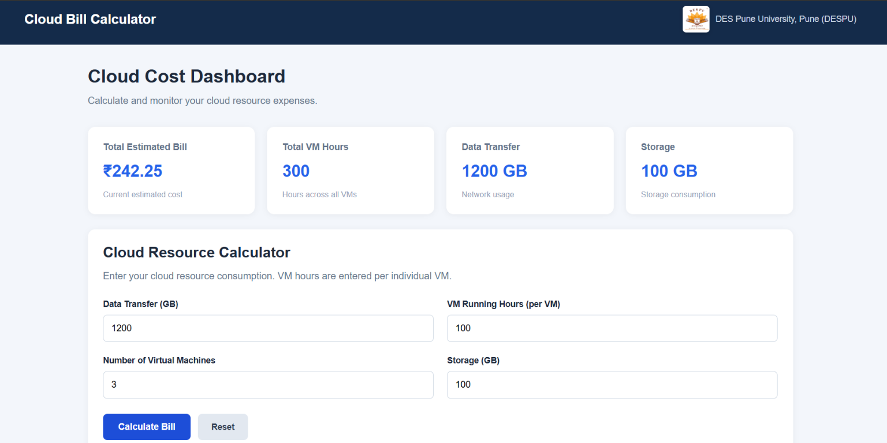
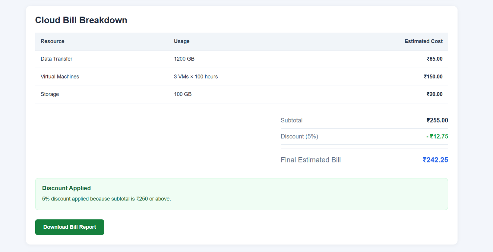
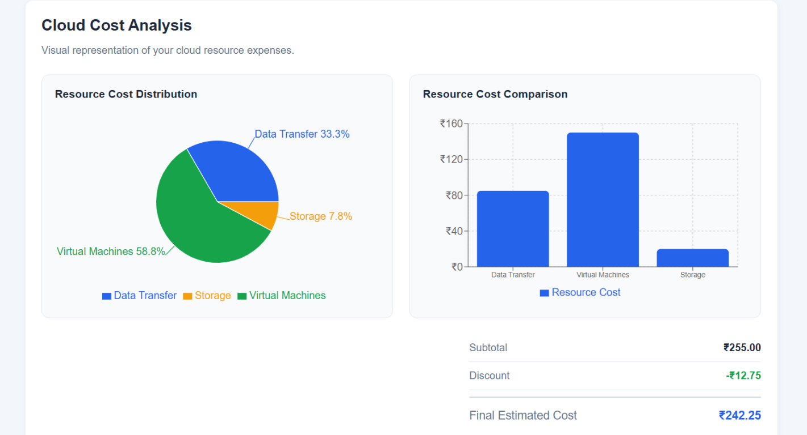

# Cloud Bill Calculator

Cloud Bill Calculator is a React-based group capstone project for estimating
cloud resource expenses. Users can enter data transfer, virtual machine usage,
VM count, and storage consumption to calculate an estimated bill in Indian
Rupees (INR).

## Features

- Cloud cost dashboard with summary cards
- Tiered pricing for data transfer and virtual machine hours
- Storage cost calculation
- Automatic 5% and 10% discount calculation
- Detailed bill breakdown
- Resource cost distribution and comparison charts
- CSV bill report download
- Input validation and reset functionality
- Project team section

## Technology Stack

- React
- Vite
- Recharts
- JavaScript (ES modules)
- CSS

## Getting Started

### Prerequisites

- Node.js 18 or later
- npm

### Installation

```bash
npm install
```

### Run the development server

```bash
npm run dev
```

Open the local URL shown by Vite, usually `http://localhost:5173`.

### Build for production

```bash
npm run build
```

### Run linting

```bash
npm run lint
```

## How Billing Works

The calculator estimates costs for:

| Resource | Pricing rule |
| --- | --- |
| Data transfer | First 500 GB at ₹0.10/GB, remaining usage at ₹0.05/GB |
| Virtual machines | First 100 hours per VM at ₹0.50/hour, remaining hours at ₹0.30/hour |
| Storage | ₹0.20/GB |

Discounts are applied to the subtotal:

- 5% for subtotals of ₹250 or more
- 10% for subtotals of ₹500 or more

## Project Screenshots

### Cloud Cost Dashboard



### Cloud Bill Breakdown



### Cloud Cost Analysis



### Project Team


## Project Team

- Ganesh Kusalkar
- Vrushika Mokashi
- Sakshi Hichami
- Jay Deshmukh

**Under the guidance of Prof. Uma Ma'am**

## Project Structure

```text
src/
├── components/     # Dashboard, form, bill, chart, team, and layout components
├── data/           # Pricing and team member data
├── utils/          # Billing calculation logic
├── App.jsx         # Main application flow
└── index.css       # Global styles
```
